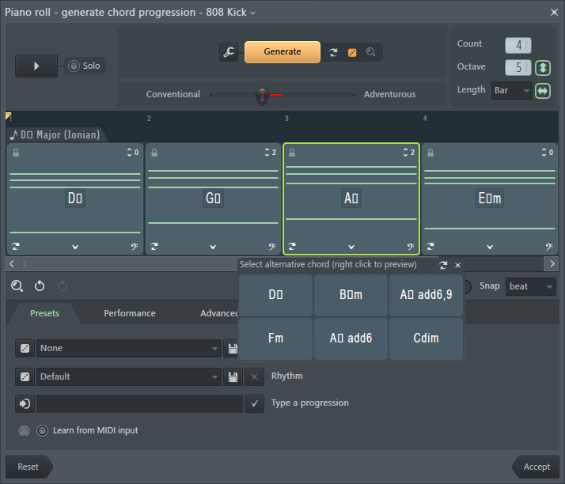
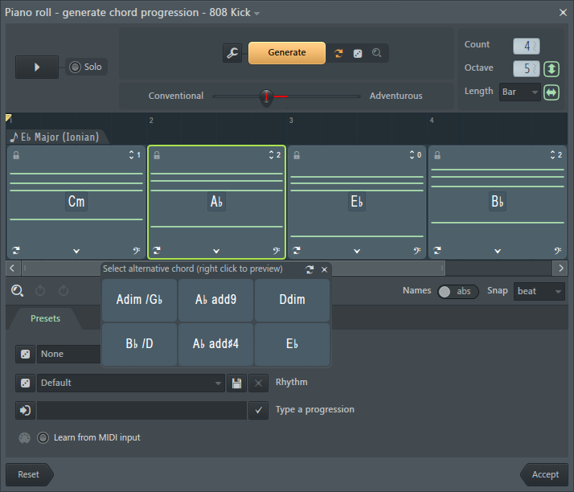

# 🎹 FL Studio Wine Font Fix

[](https://www.winehq.org/)
[](https://www.image-line.com/)
[](LICENSE)

**Fix missing musical symbols (♭ ♯) in FL Studio running under Wine**

## 🎵 The Problem

When running FL Studio under Wine, **flat (♭) and sharp (♯) symbols** appear as tofu boxes (□) in the Piano Roll - chord progression. 

| Before | After |
|--------|-------|
|  |  |
| `D□`, `G□`, `A□ add6` | `B♭`, `Gdim /B♭` |

## 🔍 Root Cause

FL Studio 2026 draws its text with its own font code (modules in `Shared\`, among them `QuickFontCache_x64.dll`
and a bundled `freetype_x64.dll`); no DirectWrite call and none of the traced GDI text calls occur on this path. It opens font files **by file
name** from `C:\windows\Fonts`: the UI font is `segoeui.ttf`, and a glyph missing from it is taken from a fixed
list of further files (`msyh.ttc`, `malgun.ttf`, `batang.ttc`, `msgothic.ttc`, `arial.ttf`, `tahoma.ttf`,
`seguiemj.ttf`). A Wine prefix contains none of these files, and Wine's font fallback, font substitution and
fontconfig settings are not on this path.

Segoe UI 5.62 (Windows 10) contains ♯ but not ♭; of FL's list, `malgun.ttf` (Malgun Gothic) is the first file
that contains ♭. Measured in a Wine prefix with FL Studio 2026 (`C♯m F♯ B♭ E♭` typed into the chord progression
tool):

| Files in `C:\windows\Fonts` | ♯ | ♭ |
|---|---|---|
| none (fresh prefix) | □ | □ |
| `segoeui.ttf` (genuine Segoe UI 5.62) | ✅ | □ |
| `segoeui.ttf` + `malgun.ttf` (genuine Segoe UI 5.62, Malgun Gothic 6.68) | ✅ | ✅ |
| DejaVu Sans as `segoeui.ttf` (this script) | ✅ | ✅ |

## ✅ Solutions

1. **With fonts from a Windows installation you own:** copy the unmodified `segoeui.ttf` and `malgun.ttf` into
   `<WINEPREFIX>/drive_c/windows/Fonts/`. This matches Windows; no font is modified.
2. **Without Microsoft fonts:** run `fix-dejavu-as-segoeui.sh`. It places DejaVu Sans (open-source, contains both
   symbols) as `segoeui.ttf` in the prefix. FL Studio then draws its whole interface in DejaVu Sans, not only the
   chord names.

### Quick Install

```bash
# Clone the repo
git clone https://github.com/giang17/flstudio-wine-font-fix.git
cd flstudio-wine-font-fix

# Run the fix (uses default WINEPREFIX ~/.wine)
./fix-dejavu-as-segoeui.sh

# Or specify a custom WINEPREFIX
./fix-dejavu-as-segoeui.sh /path/to/your/wineprefix

# FL Studio 2025: also rename the font family to "Segoe UI" (see below)
./fix-dejavu-as-segoeui.sh --rename /path/to/your/wineprefix
```

Existing `segoeui.ttf`/`segoeuib.ttf` files are backed up next to the new ones (`*.backup.<date>`).

### Requirements

- Python 3
- python3-fonttools
- DejaVu Sans font

```bash
# Ubuntu/Debian
sudo apt install python3-fonttools fonts-dejavu-core

# Or via pip
pip3 install fonttools
```

## 🔄 Restore Original

To remove the fix:

```bash
rm ~/.wine/drive_c/windows/Fonts/segoeui.ttf
rm ~/.wine/drive_c/windows/Fonts/segoeuib.ttf
```

If the script made a backup, rename the `*.backup.<date>` file back instead.

## 🔧 Why This Works

FL Studio 2026 opens `C:\windows\Fonts\segoeui.ttf` directly and does not check the family name inside the
file. DejaVu Sans in that file supplies ♭ and ♯ itself, so FL's own fallback list is not needed.

FL Studio 2025 asked DirectWrite for the family "Segoe UI" instead. For that version `--rename` also renames the
font family inside the copied file to "Segoe UI". The renamed font is then what every application in the prefix
gets when it asks for "Segoe UI", which is why it is no longer the default.

### What Doesn't Work

- ❌ Fontconfig aliases: FL Studio 2026 does not ask Wine for a font family at all.
- ❌ Wine Registry `FontSubstitutes`: FL Studio 2026 looks fonts up by file name, not by family name.
- ❌ Wine `dwrite.dll` patches: FL Studio 2026 does not load `dwrite.dll`. (FL Studio 2025 used
  `IDWriteFontFace::GetGlyphIndices`, which does not fall back to other fonts, see
  [Wine Bug #59252](https://bugs.winehq.org/show_bug.cgi?id=59252), comment 14.)

### Environment Tested

- **FL Studio**: 2026 (26.1.7, FL64.exe), Wine 11.0 with the patches of [giang17/wine](https://github.com/giang17/wine)
  (`d2d1-dcomp-11.0`); earlier version of this fix: FL Studio 2025 (build 5171), Wine 11.0
- **Windows reference fonts**: Windows 10 22H2 (Segoe UI 5.62, Malgun Gothic 6.68)
- **OS**: Ubuntu 26.04 LTS (this script with FL Studio 2026), Ubuntu 24.04 LTS (FL Studio 2025)

## 🐛 Related

- [Wine Bug #59252](https://bugs.winehq.org/show_bug.cgi?id=59252) - Original bug report with full analysis

## 📁 Files

| File | Description |
|------|-------------|
| `fix-dejavu-as-segoeui.sh` | Automated fix script |
| `screenshots/` | Before/after screenshots |

## 🤝 Contributing

Found another missing symbol? Have a fix for a different font? PRs welcome! 

## 📜 License

MIT License - See [LICENSE](LICENSE)

**Font Licensing:**
- This tool uses **DejaVu Sans** (licensed under [SIL Open Font License](https://dejavu-fonts.github.io/License.html)) and renames it to "Segoe UI" for technical compatibility purposes.
- "Segoe UI" is a trademark of Microsoft Corporation.
- The renamed font files are created locally on your system for **personal use only**.
- This project does not distribute any Microsoft fonts or modified font files.

## 🙏 Acknowledgments

- Wine developers for DirectWrite implementation
- Nikolay Sivov for DirectWrite expertise and guidance
- The Wine and FL Studio community
- DejaVu Fonts team for the excellent open-source font

---

**Made with ♭♯ for the music production community**
